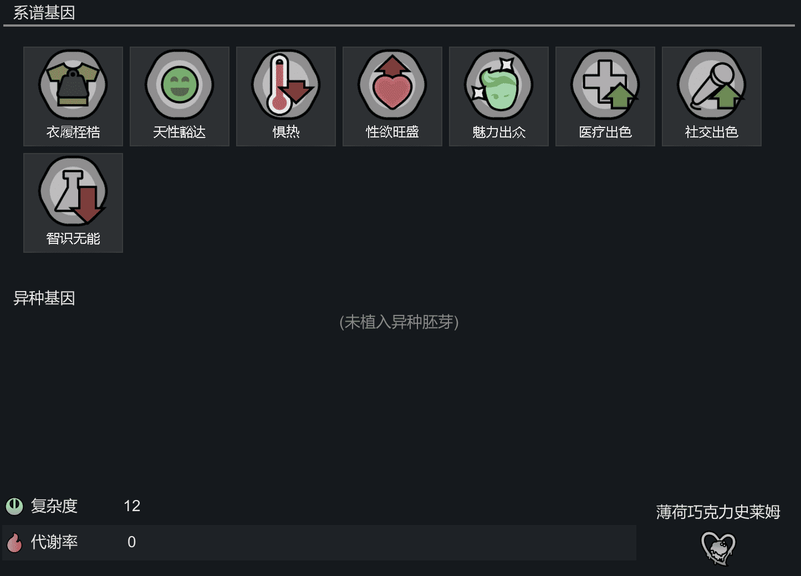
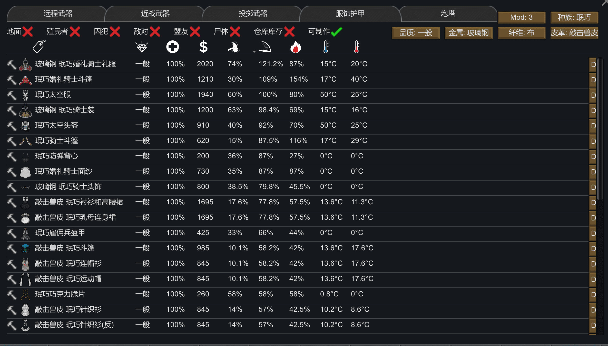

纯娱乐种族,几乎无内容,食之无味

<!-- more -->


## 种族本体
|属性|智人种|珉巧|
|---|---|---|
|生命值系数|100%|300%|
|基础价值|1750|2000|
|易燃性|70%|200%|
|重量|60|56|
|肉量|140|0|
|皮革量|75|0|
|移动速度|4.6|4|
|携带能力|75|150|
|最低舒适温度|16|-300|
|最高舒适温度|26|23-5|
|心灵敏感度|100%|0%|
|毒素抗性|0%|100%|
|有毒环境抗性|0%|100%|
|真空抗性|0%|100%|
|崩溃临界值|35%|3%|
|疼痛休克阈值|80%|100%|
|预期寿命|80|500|
|全局学习系数|100%|80%|
|休息效率乘数|100%|140%|
|免疫速度|100%|400%|
|生育周期|15|30|
|觅食能力|0|1.4|
|进食速度|100%|200%|
|利器护甲|0%|40%|
|钝器护甲|0%|20%|
|抑止时间乘数|100%|0%|
|谈判能力|100%|90%|
|交易价格改善|100%|90%|
|社交效果|100%|90%|
|魅力|0|0+1|
|全局工作速度|100%|90%|

还有如下种族本体的杂项内容
 -  仅有女性,免疫老年疾病,不会生成亲戚关系,仅能穿戴珉巧专属衣物,背景故事禁用智识并赋予自然灵媒(婴儿仍无法研究)
 -  使用珉巧器官树,不会累计疼痛,无法使用大部分植入物仿生体
 -  分为薄荷巧克力,蓝色北极熊,坠入粉色爱河三种,三者仅有外形和产出有区别
 -  每0.5天产出20个当前口味的冰淇淋,死亡时候没有尸体,非殖民者死亡时掉落5薄荷巧克力,殖民者死亡时掉落40薄荷巧克力
 -  免疫如下状态:失血,低温症,食物中毒,毒气,中毒,心脏病发作,感染,珉巧感染,真空暴露,眼睛进沙,冰淇淋头痛,珉巧感染
 -  珉巧不会中暑但会融化,其和原版中暑几乎一致,仅是100%时不致死,且融化状态下心情-5
 -  空手 10(钝击,捅伤,割伤)/s,每10s所有伤口疤痕回复0.2血量,疾病严重度下降0.2,10%概率移除金属怪形植入

<!-- 部分背景故事带有1天的"冷冻的"状态移动能力-100% 操作能力-100% 疼痛+10% 心情-5,实际测试未观察到,也不重要就不做探究了 -->

```text
名称              血量  内外   覆盖率        命中率
珉巧躯干         120HP  OS       100       98.994%
├─ 颈部           75HP  OS     0.001       0.0008%
│  └─ 珉巧头部    75HP  OS        20       0.0002%
├─ 珉巧核心       30HP  IS         1            1%
│  └─ 思维核心    30HP  IS  0.000001   0.00000001%
├─ 珉巧眼点       30HP  IS     0.001        0.001%
├─ 左/右肩        90HP  OS     0.001        0.001%
├─ 左/右腿        90HP  OS     0.001        0.001%
└─ 腰部            0HP  OS         0            0%
```

基础数值真没啥看的,移速慢点低温耐点,心灵失聪且崩溃临界值只有3%,毒素真空抗性全满,剩下杂项参数自己看  
虽然说300%的生命值系数最多能承受450点伤害,但珉巧几乎只有躯干会受到伤害,且躯干仅有120血  
禁止智识还是很难受的,珉巧开必须要绑其他种族来跑科技树.自然灵媒搭配0%心灵敏感度真是给我看笑了,用处在哪?自己冥想出仙草然后给珉巧女巫启灵吗  
每天产4营养值的冰淇淋,电表倒转这一块.死亡没尸体略微影响死亡回避(可以用一个高级零部件保留尸体)  
珉巧空手打人还挺痛的,攻速还快的一笔,伤口愈合特性强力但不多,相当于每天所有伤口回20点血,说多不多说少不少,战斗中意义不大(除非你能把承伤叠到很低,让敌人打出来都是1伤以下的伤口),但战后恢复速度那就甩原版超速愈合十几条街了,懂不懂所有伤口并行回血的含金量.除此之外还能防金属怪形植入,我只能说女子

### 基因&特性&心情


**基因** 珉巧基因固定为 衣履桎梏;天性豁达;惧热;性欲旺盛;魅力出众;医疗出色;社交出色;智识无能 总计0代谢,未增加新基因

衣履桎梏都来了,本来跑的就慢,穿衣服还掉0.2移速,整套基因组都没啥大用

**特性** 珉巧必定没有如下特性:排外主义,裸体主义,聪明过人,超人主义,纯粹主义,受虐狂,纵火狂,懦弱,速学者,过目不忘,心理变态,嗜血,坚韧,敏捷,直来直去,厌恶男性,厌恶女性,烦人的声音,恶心的呼吸声,体弱多病,超免疫者,移速全家桶,心灵敏感度全家桶,魅力全家桶,成瘾品全家桶

**心情**
<details>
<summary>点击查看AI扒取特殊心情</summary>

珉巧免疫如下心情:
 -  裸体,穿着死人衣服,衣服破损
 -  吃了粗饲料,吃了精致餐,吃了豪华餐,在豪华餐厅吃饭,吃了虫肉(原料/直接),吃了人肉(原料/直接),吃了生食,吃了腐烂食物,没有桌子吃饭
 -  睡在户外,睡在地上,睡在寒冷中,睡眠被打扰,卧室心情,营房心情,共用床铺
 -  在豪华娱乐室娱乐,舒适需求,空间需求,户外需求
 -  头衔食物不合适,头衔衣物不满足,头衔衣物品质不满足(皇权)

特殊心情:
 -  薄荷巧克力的清新:状态值≥0%/40%/70%/90% 心情+2/+3/+4/+5
 -  蓝色北极熊的温和:状态值≥0%/50%/90% 心情+1/+2/+3
 -  坠入粉红色爱河的可爱:状态值≥0%/50%/90% 心情+1/+2/+3
 -  薄荷醇烟:+15
 -  融化的身体:-5
 -  冷冻的身体:-5
 -  命运的邂逅:+15,持续20天(仅有Def,没有任何代码或事件会触发,实际无法获得)
 -  殖民地的孩子(乳母特性):殖民地有婴儿或儿童时+10
 -  婴儿哭闹(乳母特性):听到婴儿哭闹时+1(代替原版的负面心情)
 -  珉巧女巫相关:地图上有珉巧女巫殖民者时珉巧+3
 -  食用珉巧婴儿食品:心情+2,持续1天
 -  食用薄荷巧克力拿铁:心情+3,持续1天
 -  食用薄荷巧克力甜甜圈:心情+6,持续1天
 -  食用薄荷巧克力蛋糕:心情+13,持续1天
 -  食用薄荷棒棒糖:心情+10,持续1天
 -  食用薄荷钉锤糖:心情+10,持续1天
 -  食用珉巧女巫的苹果蛋糕:心情+10(状态值超过65%时追加 心情+20),持续1天
 -  薄荷巧克力生物膜(灵能):心情+2,持续12小时
 -  珉巧感染:状态值≥1%/25%/50%/75% 心情-5/-10/-15/-20
</details>

## 杂项娱乐内容
### 身形&植物&食物
身形
 -  巧克力人形饼干:1巧克力+1稻米    仅珉巧和珉巧女巫可食用 食用后变为人腿体型
 -  薄荷史莱姆饼干:1珉巧薄荷叶+1稻米 仅珉巧和珉巧女巫可食用 食用后变为史莱姆腿体型
 -  薄荷巧克力饼干:1珉巧薄荷叶+1稻米 仅珉巧和珉巧女巫可食用 食用后变为薄荷巧克力发色,产物变为薄荷巧克力
 -  蓝色北极熊饼干:1珉巧薄荷叶+1稻米 仅珉巧和珉巧女巫可食用 食用后变为蓝色北极熊发色,产物变为蓝色北极熊
 -  坠入粉色爱河饼干:1珉巧薄荷叶+1稻米 仅珉巧和珉巧女巫可食用 食用后变为坠入粉色爱河发色,产物变为坠入粉色爱河

没有任何作用的饼干,纯暖暖来的

植物
 -  珉巧薄荷:1天生长时间 10珉巧薄荷叶产出 日产出5.42薄荷叶  
    珉巧薄荷叶:0.5银0.05营养值5天腐烂 无法食用无法作为食物原料
 -  珉巧蘑菇:只能在蘑菇模具种植 3天生长时间 6珉巧蘑菇产出 -272~0℃生长温度,日产出1.08珉巧蘑菇  
    珉巧蘑菇:3银0.1营养值10%娱乐值

没有任何作用的植物,珉巧薄荷产出高但是没法作为食物原料,只能拿来搓一些没啥用的东西.珉巧蘑菇幽默产出

食物
 -  薄荷巧克力/蓝色北极熊/坠入粉色爱河:珉巧产出 3银0.1营养值1天腐烂,食用后获得20%对应清新状态,状态值每天自然下降60%  
    薄荷巧克力的清新:状态值≥0%/40%/70%/90%时 心情+2/+3/+4/+5 特别地,状态值≥90%时平均获得3天一次冰淇淋头痛状态  
    蓝色北极熊的温和/坠入粉红色爱河的可爱:状态值≥0%/50%/90%时 心情+1/+2/+3 特别地,状态值≥90%时平均6天获得一次冰淇淋头痛状态  
    冰淇淋头痛:疼痛+10%,持续2h左右,珉巧免疫此状态,珉巧女巫获得此状态时转为永久的"冰镇大脑"状态,心灵熵消散速率×110%
 -  5薄荷巧克力=7珉巧薄荷叶+5巧克力;20薄荷巧克力=25珉巧蘑菇;4巧克力=5冰淇淋
 -  半加仑冰桶(内含巧克力/蓝色北极熊/坠入粉色爱河):2原木+15巧克力/蓝色北极熊/坠入粉色爱河 48银1.5营养值,食用后获得100%对应清新状态,并获得冰淇淋头痛状态,可拆回成15对应冰淇淋
 -  12珉巧婴儿食品=3冰淇淋类 1.25银0.05营养值14天腐烂10%娱乐值 心情+2持续一天 可作为婴儿食物
 -  薄荷巧克力拿铁:珉巧拿铁产出 19.5银0.9营养值3天腐烂50%娱乐值 心情+3持续一天
 -  薄荷巧克力甜甜圈:3冰淇淋+5素食 20银0.9营养值3天腐烂50%娱乐值 心情+6持续一天
 -  薄荷巧克力蛋糕:5冰淇淋+10素食 36银1营养值3天腐烂70%娱乐值 心情+13持续一天
 -  薄荷棒棒糖:75珉巧薄荷叶 90银0.8营养值100%娱乐值 心情+10持续一天 可作为武器,15钝击/2s,9捅伤/2s
 -  薄荷钉锤糖:3薄荷棒棒糖 270银2.4营养值300%娱乐值 心情+10持续一天 可作为武器,25钝击/2s,15捅伤/2s  
    食用后获得一天的"觉醒到使人精神振作的暴力行为中",近战命中率+0.1
 -  除此之外还有一些将衣物还原为食物的配方,没啥用故不再统计

半加仑冰桶是储存冰淇淋用的,也能当方便面pro max拿出去卖,其他就没啥用了

### 材料&建筑
材料
 -  薄荷巧克力砖:石材 3.75银70%耐久100%易燃性 25/100利钝器伤害130%近战冷却时间 50%美观度45%开门速度90%休息效率  
    4薄荷巧克力砖=5薄荷冰淇淋;4冰淇淋=5薄荷巧克力砖
 -  巧克力棒:木材 3.75银52%耐久100%易燃性 43/43/32三防 32/72利钝器伤害 200%美观度120%开门速度 可作为武器,8钝击/2s  
    4巧克力棒=5巧克力;4巧克力=5巧克力棒

薄荷巧克力砖贵的流油而且耐久低,我唯一能想到的用处是搓艺术品卖钱,算上品质加成还是比冰淇淋桶赚的多的  
巧克力棒更是垃圾,还得种可可树这个原版最没存在感的东西,唯一的作用是搓巧克力脆片这个唯一能穿的贴身衣物

建筑
 -  珉巧工作台:65冰淇淋 2x1 120%工作速度(断电时80%) 100w耗电
 -  珉巧烛台(上/中/下/左/右):2巧克力棒+5薄荷巧克力砖         5美观度 10半径照明,每天消耗2巧克力棒
 -  珉巧电烛台(上/中/下/左/右):25W2巧克力棒+5薄荷巧克力砖    5美观度 10半径照明,25w耗电
 -  珉巧超大烛台:20巧克力棒+40薄荷巧克力砖 2x2大小 230银    10美观度 10半径照明 制热25/s(最高25℃),每天消耗3巧克力棒
 -  珉巧超大电动烛台:20巧克力棒+40薄荷巧克力砖 2x2大小 230银 10美观度 10半径照明 制热21/s(最高25℃),175w耗电
 -  珉巧蘑菇模具:20金属/木材/石材 1x1大小     只能种植珉巧蘑菇
 -  珉巧蘑菇模具(长):60金属/木材/石材 1x3大小 只能种植珉巧蘑菇
 -  薄荷巧克力墙:6薄荷巧克力砖 250耐久 每2000tick回复1点耐久 受炸伤×2 被摧毁不返还材料
 -  巧克力地板:3巧克力棒
 -  薄荷巧克力石板:4薄荷巧克力砖
 -  薄荷巧克力地砖:4薄荷巧克力砖 0.5美观度
 -  精致的薄荷巧克力地砖:20薄荷巧克力砖 1.5美观度
 -  珉巧可丽饼睡袋:35稻米 1x2大小 0.68舒适度 95%休息效率105%免疫速度  5床铺愈合速度
 -  珉巧单人蛋糕床:35巧克力棒+15薄荷巧克力砖 1x2大小 550银 75美观度1舒适度 110%休息效率110%免疫速度 5床铺愈合速度
 -  珉巧全尺寸蛋糕床:75巧克力棒+30薄荷巧克力砖 2x2双人床 1100银 150美观1舒适度 110%休息效率110%免疫速度 5床铺愈合速度
 -  珉巧马卡龙椅:30薄荷巧克力砖 120银 8美观度0.6舒适度
 -  珉巧马卡龙靠背椅:54薄荷巧克力砖 210银 11美观度0.84舒适度
 -  珉巧扶手椅:132薄荷巧克力砖 210银 24美观度1.2舒适度
 -  珉巧甜点宝座:250巧克力棒+50薄荷巧克力砖 3x2大小 2200银 15美观 1舒适,视为皇权宏伟宝座
 -  薄荷巧克力派对桌(文化):3薄荷巧克力蛋糕+3珉巧薄荷巧克力饼干+130冰淇淋 4x2大小 20美观 "珉巧主义"模因的消耗型建筑

全是没用的东西,财富值高到流油数值还一般,可以整点马卡龙靠背椅出去卖,其他就算了,又贵又没用

### 动物&杂项
动物,添加了三种动物,无性别无法繁殖无心灵敏感度,每20s所有伤口回1点血,无疼痛累计,共享免疫列表,死亡时无尸体,而是掉落40×体型的薄荷巧克力,使用类珉巧身体树,可在商队或据点购买,也可通过事件获得
 -  珉巧喵:350银0.255体型100%生命值系数4移速0.16食物消耗 10(钝击,捅伤,割伤)/s 每2天产出10薄荷巧克力
 -  珉巧汪:350银0.86体型105%生命值系数4.3移速0.8食物消耗 12(钝击,捅伤,割伤)/s 每2天产出25薄荷巧克力
 -  珉巧拿铁:770银2.4体型175%生命值系数5移速0.68食物消耗 8.5(钝击,捅伤,割伤)/s 每2天产出1薄荷巧克力拿铁

宠物还是很有用的,除了珉巧拿铁都能产出电表倒转,其近战能力也非常强,但真的太脆了,只有40血,打两下就死了,再加上珉巧女巫有转换bug导致这仨获取相当困难,属于是有就业空间但是招不到员工

杂项
 -  添加了剧本"珉巧的殖民地",4珉巧开局,其余内容和迫降几乎一致,不会与帝国永久敌对
 -  添加了手术"珉巧辅助核心",消耗1高级零部件,全局工作速度+25%,死亡后正常留下尸体
 -  添加了派系"冰霜妻子",默认中立的工业科技等级派系,文化结构模因固定为珉巧主义  
    商队为冰淇淋小贩和经销商,前者只售卖没用的珉巧基础材料,并会出售珉巧动物和150~250魔菇布,后者只售卖珉巧动物和150~250魔菇布
 -  添加了珉巧主义文化结构模因,规定如下戒律
     -  外星种族:重视 与外星种族约会:喜好 肉欲:推崇 女性的配偶:无限制 男性的配偶:忠贞 女性装束:无规则 男性装束:无规则
     -  处决:畏惧冤罪 仁善:愉悦 失明:畏惧 多元文化:认同 疤痕:畏惧 枭示:反感
     -  解锁仪式:薄荷巧克力派对 仪式会消耗薄荷巧克力派对桌
 -  添加了如下成瘾品
     -  珉巧奥数药水:10珉巧薄荷叶+1中性胺 仅珉巧和珉巧女巫可食用 食用后获得5.55天的"珉巧增加心灵敏感度"状态,心灵敏感度+40%
     -  薄荷醇卷烟:8珉巧薄荷叶+4大麻叶 80%娱乐值 10%休息值 无随机过量几率,成瘾太复杂了不做统计  
        使用后获得12h的薄荷醇烟状态,疼痛-20% 意识+5% 饥饿率+60% 心情+15

珉巧辅助核心很重要,奥数药水可以让珉巧临时获得心灵敏感度,拿来当机械师或者啥的,其他就没啥用了

事件
 -  珉巧流浪者加入(`WandererJoin_Mincho`):0.25权重 字面意义
 -  蓝色北极熊流浪者加入(`WandererJoin_BluePolarBear`):0.25权重 字面意义
 -  坠入粉红色爱河流浪者加入(`WandererJoin_PinkFallInLove`):0.25权重 字面意义
 -  珉巧喵加入(`WandererJoin_Mincho_Minchonyang`):0.25权重 一只珉巧喵加入殖民地
 -  珉巧汪加入(`WandererJoin_Mincho_Minmoong`):0.25权重 一只珉巧汪加入殖民地
 -  珉巧拿铁加入(`WandererJoin_Mincho_MinchoLatteIsHorse`):0.25权重 一只珉巧拿铁加入殖民地
 -  坠毁的珉巧婴儿食品(`Mincho_BabyFoodPod`):1权重 世界存在冰霜妻子且殖民地有婴儿时概率触发,天上掉下来37~74个珉巧婴儿食品
 -  派遣珉巧保姆提议(`Mincho_WetNurse_JoinQuest`):任务 玩家派系出生了非珉巧婴儿且玩家派系中没有任何有"保姆天性"特性时触发,一名带有"保姆天性"特性的珉巧保姆加入殖民地
    保姆天性:事件珉巧专属特性 烹饪+2 社交+2 手工+1 医疗+2 治疗质量+20% 社交效果+25% 禁用暴力 泌乳量与上限×8且泌乳永不消退,无视泌乳带来的生育能力惩罚

## 武器
近战武器
 -  薄荷巧克力球枪:50薄荷巧克力砖+300黄金+5零部件 23钝击/2s 9捅伤/2s 近战可攻击11范围内敌人
 -  薄荷巧克力大剑:50薄荷巧克力砖+300黄金+5零部件 23(刺伤,割伤)/2.6s 9钝击/2s  
    附带技能"跳跃攻击":0.5s前摇2h cd,10释放半径5爆炸半径,位移至目标格,并对5半径内非友方生物造成23点点眩晕,并生成5半径的10s陨石坑,提供45%掩体  
    附带技能"旋转斩":无前摇2h cd,对4半径内的所有敌人造成5次0%穿甲的23点割伤,使用该技能击杀时返还5s cd,被该技能攻击到击杀的敌人死亡时头部会消失并掉落"头颅"

球枪数值还算可以,与铀钉头锤基本一致,且可以远程近战(必中),但300黄金消耗真不是给人搓的,更况且珉巧空手近战就有10的dps,这球枪无非是多了个品质加成,只能说是后期玩具  
大剑数值非常低下,主要是近战间隔太高了,dps都不如同品质下的玻璃钢匕首,但他这俩技能真有说法的,一个闪现眩晕,一个出伤,虽然0%穿甲但伤害还算可观,基本等价于两个高爆弹伤害,返还cd基本就别考虑了,杀一个才返5s,你得一下转死18个人才能无缝衔接技能.基础数值拉到爆,技能数值还算优秀,造价十分高昂,本质来说还是后期玩具

远程武器
 -  太空扫帚:无法制作,会作为远程武器出现在交易列表或任务奖励中 4000银 心灵敏感度+50% 心灵熵消散速率+0.083,拥有三种模式  
    普通模式:近似等价于电荷步枪 1s前摇1.7s后摇28射程35%穿甲3×16伤,60/70/65/55四距离精度,传奇级22.3dpsa,叠1%瞄准时间后32.7dpsa  
    集中模式:完全等价于广域射线炮 1s前摇1.7s后摇4~25射程50%穿甲10烧伤  
    扩散模式:近似等价于脉冲射线炮 4s前摇1.7s后摇22射程50%穿甲30×5烧伤,60/70/65四距离精度,传奇级21.6dpsa,叠1%瞄准时间后34.7dpsa  
    附带技能"宇航推进器",无前摇无cd,释放半径由品质决定(极差3半径到传奇9半径),5次存储,每次使用消耗5薄荷巧克力砖,位移至目标格,无法穿墙

普通模式相当于远程冷却时间略短(2s->1.7s),四距离精度更高(55/64/55/45->60/70/65/55)的电荷步枪,其余数据完全一致,传奇1%瞄准下dpsa由26提升至32.7  
集中模式则和广域射线炮完全一致,只是能吃到品质加成  
扩散模式也是远程冷却时间略短(3s->1.7s),四距离精度更低(65/72/65->60/70/65)的脉冲射线炮,其余数据完全一致,传奇1%瞄准下dpsa由30.1提升至34.7

你的意思是我只需要花4000银就可以买到灵质权杖,增强版电荷步枪,广域射线炮和增强版脉冲射线炮这四把武器的四合一版本?实在是太强力辣  
虽然说电荷步枪放到原版强度也不低,稍微减少了冷却时间并提高精度也是好事,但纯换皮也太生草了.脉冲射线炮略微改进了逆天后摇,带的闪现也将将能用

## 衣物


大量衣物几乎无防御能力,且效果为没用的加社交效果,故不进行统计,只统计战斗衣物
 -  珉巧骑士头饰:80金属 70%S 头饰
 -  珉巧婚礼骑士面纱:65魔菇布+300黄金 87/35/87三防 头饰
 -  珉巧巧克力脆片:50巧克力棒 58/58/58三防 贴身
 -  珉巧雇佣兵盔甲:150钢铁+20布 66/33/44三防 夹层
 -  珉巧骑士装:80金属+30魔菇布 30%+60%S 夹层
 -  珉巧婚礼骑士礼服:150金属+50魔菇布 30%+80%S 夹层
 -  珉巧防弹背心:25布+50钢铁+1零部件 87/36/27三防 外套
 -  珉巧骑士斗篷:100魔菇布 87.5/15/116三防 外套
 -  珉巧婚礼骑士斗篷:200魔菇布 109/30/154三防 外套
 -  珉巧太空头盔:2高级零部件+50玻璃钢 92/40/70三防 射击精度+3 全局工作速度+5% 真空抗性+69% 免疫毒气
 -  珉巧太空服:4高级零部件+100玻璃钢+10铀 100/60/80三防 夹层 移速+1.5 全局工作速度+5% 真空抗性+32% 必须为人腿体型
 -  珉巧太空飞翼:2高级零部件+50玻璃钢+10铀 40/40/0三防 外套 移速+2 必须为人腿体型且同时穿着珉巧太空服  
    附带技能"宇航推进器",无前摇无cd,释放半径由品质决定(极差3半径到传奇9半径),5次存储,每次使用消耗5薄荷巧克力砖,位移至目标格,无法穿墙
 -  兔女郎尾巴:20钢铁+10化合燃料+1零部件 占用配件层
    附加技能"投掷兔女郎尾巴手雷":0.5s前摇仅能使用一次,25释放半径5爆炸半径1.9强制偏移,对范围内生物造成10%穿甲的50点炸伤(受品质影响),并在落点11×11范围内随机3处造成10%穿甲4半径的50点烧伤(受品质影响)

这衣服也没啥好说的,毕业衣服需要魔菇布,记得种恶魔菇  
头饰骑士没啥用,珉巧头部只有0.001%的命中率,这要被打中了可以去买彩票了.骑士头饰=防弹头盔,骑士面纱=区,太空头盔>玻璃钢骑士头饰,前期骑士头饰,中后期换太空头盔  
贴身只有这一件,不想穿也得穿,夹层前期雇佣兵盔甲,出了魔菇布之后换婚礼骑士礼服,这玩意还是比雇佣兵盔甲硬了不止一个档次的  
外套首选防弹背心,珉巧几乎只有躯干,这防弹背心可太香了.骑士斗篷是不如防弹背心的区,婚礼骑士斗篷则是魔菇布多到用不完时的补强  
至于太空套,基本算是舍弃了部分防御的移速补强,如果你对移速有比较高的追求,可以选择太空套,我还是更喜欢肉装  
最后的兔女郎尾巴就非常牛逼了,相当于丢一个大半径高爆弹再丢一个三联火箭,甚至能吃到品质加成,传奇级伤害翻1.5倍,一个技能下去直接给1w点袭击肘飞了,也就是这个技能导致我把这个mod归类为正义

最后来算算护甲承伤,由于珉巧头部命中率实在太低,我们干脆把所有护甲都当成全防护甲来计算
 -  前期钢铁极佳 巧克力脆片+雇佣兵盔甲+防弹背心+自带防(75.4;85.8;113.1;40);在20%穿甲下护甲承伤为7.6%
 -  后期玻璃钢传奇 巧克力脆片+婚礼骑士礼服+婚礼骑士斗篷+自带防(104.4;200;196.2;40);在20%穿甲下护甲承伤为0.09%,如果再叠上石肤和薄荷巧克力生物膜(自带防+70%+35%)后,在20%穿甲下的护甲承伤为0.02%

你知道这个数值有多夸张吗?前期一套极佳钢铁甲比原版传奇骑士套还抗揍,0.09%的护甲承伤更是相当于血量翻了1111倍!当然,翻再多倍也没用,毕竟护甲就那几百点耐久,打着打着护甲爆了都变浮云了

## 珉巧女巫
### 种族本体
|属性|智人种|珉巧女巫|
|---|---|---|
|基础价值|1750|2100|
|荣誉点数|3|15|
|易燃性|70%|100%|
|皮革量|75|50|
|最低舒适温度|16|-100|
|最高舒适温度|26|30|
|心灵敏感度|100%|150%|
|预期寿命|80|100|
|生育周期|15|45|

 -  仅有女性,无基因,使用人类器官树,免疫老年疾病,可穿戴原版衣物和珉巧衣物,带有自然灵媒
 -  必定带有聪明过人,嗜血,善良特性,必定没有丑陋,丑绝人寰特性
 -  背景故事固定为智识+15 医疗+10 种植+7 手工+3 社交+3 驯兽+3 烹饪+3 艺术+3 射击-5 格斗-5 建造-5 采矿-5
 -  生成时自带1级启灵,珉巧女巫提升启灵等级时只会获得指定女巫灵能,而不是原版随机灵能
 -  免疫珉巧转换,不会获得"冰淇淋头痛"状态,而是转为永久的"冰镇大脑"状态,心灵熵消散速率×110%

心灵敏感度高点的智人种

### 杂项
 -  添加了如下配方
     -  珉巧女巫普通饼干:1巧克力+1稻米 仅珉巧女巫可食用 食用后变为人腿体型和发色
     -  珉巧女巫帽:30布+50薄荷巧克力砖 心灵敏感度-20% 心灵熵恢复速率+0.1
     -  珉巧女巫贴身内衣裤:50布+50薄荷巧克力砖心灵熵恢复速率+0.03
     -  珉巧女巫长袍:50布+50薄荷巧克力砖 心灵熵恢复速率+0.08
 -  添加了手术"安装冰淇淋肢体",消耗任意半加仑冰淇淋 替换肩或腿 50%效率 饥饿效率-15%
 -  添加了剧本"珉巧女巫的实验",三智人开局,开局三人固定带有珉巧感染,且带有一个复活机械液和珉巧感染治疗药水,第7~8天必定触发珉巧女巫加入,其余与迫降几乎无异
 -  添加了事件"流浪珉巧女巫加入(`WandererJoin_MinchoWitch`)":最早第7天触发,3权重,只能触发一次,世界中已存在珉巧女巫时无法触发

### 灵能&珉巧转化
珉巧感染与转化
 -  珉巧感染:每天自然增长15%,包扎时每天自然增长(15%-15%×治疗质量)
    状态值≥1%时,心情-5;状态值≥25%时,心情-10  
    状态值≥50%时,心情-15,平均每10天将一个肩或腿替换为冰淇淋肢体  
    状态值≥75%时,心情-20,平均每3天将一个肩或腿替换为冰淇淋肢体  
    状态值≥100%时,进行珉巧转化
 -  珉巧感染治疗药水:50珉巧薄荷叶+75薄荷巧克力 使用后治疗珉巧感染
 -  珉巧女巫的苹果蛋糕=20珉巧薄荷叶+5薄荷巧克力
    非珉巧使用时获得50%的"珉巧女巫的冰凉苹果蛋糕"状态(受体型影响),心情+10,每天自然下降75%,超过65%时获得"珉巧感染"状态,心情+20
    珉巧或珉巧女巫使用时仅有心情加成.同时可作为迫击炮弹,造成5爆炸半径无视护甲的1点伤害,每点实际伤害附加50%的"珉巧感染"状态

原目标|珉巧|珉巧拿铁|珉巧汪|珉巧喵|20薄荷巧克力
---|---|---|---|---|---
殖民地人形目标|100%|0|0|0|0
殖民地高级训练度动物|5%|23.8%|35.6%|35.6%|0
殖民地中级训练度动物|0|28.8%|35.6%|35.6%|0
殖民地无训练度动物|0|0|5%|23.8%|71.2%
其他人形目标|5%|23.8%|35.6%|26.7%|8.9%
其他高级训练度动物|1%|5.0%|23.5%|35.3%|35.3%
其他中级训练度动物|0|1%|5.0%|94.0%|0
均不满足的生物|0|0|0|0|100%

珉巧转化概率如上表,触发珉巧转化时,会将目标转换为珉巧或珉巧动物,技能等级,兴趣度,特性,社交关系等会被保留,珉巧禁止的特性会在转换后清除,友军转换时保留派系,敌对转换时变为野人,动物转化成珉巧时生成新的珉巧  
特别地,种族转换有bug,目前只能变成珉巧或薄荷巧克力,无法变为三种动物(会报错并无事发生)

添加了如下技能,它们对心灵失聪者和机械族无效
 -  寒冷:1级灵能,0.25s前摇,25释放半径2爆炸半径,10熵25%精神力消耗,为范围内生物施加50%的"低温症"状态,对友军使用-20好感
 -  薄荷巧克力生物膜:2级灵能,0.25s前摇,25释放半径2爆炸半径,10熵5%精神力消耗,为范围内生物施加12h的"薄荷巧克力生物膜"状态,三防+35/10/30 移动能力-10% 心情+2
 -  升华:3级灵能,0.25s前摇,25释放半径单体,25熵15%精神力消耗,将目标进行珉巧转化,对友军使用-10好感
 -  升华之息:4级灵能,0.25s前摇,25释放半径3爆炸半径,40熵30%精神力消耗,为范围内生物施加50%的"珉巧感染"状态,对友军使用-15好感
 -  召唤珉巧魔像:5级灵能,1s前摇,25释放半径,50熵45%精神力消耗,在目标格召唤珉巧魔像,26.7小时后消失,带有狂暴精神状态  
    珉巧魔像 8体型5.5移速1000%生命值系数100/100/50三防25%承伤无疼痛累计 近战60钝击/2s
 -  召唤珉巧辐射信标:6级灵能,1s前摇,25释放半径,100熵75%精神力消耗,生成珉巧辐射信标  
    珉巧辐射信标每分钟为全地图的非屋顶下的非机械族生物施加0.0288×毒素抗性×(0.85~1.15)的"珉巧感染"状态

连放两发寒冷可以直接让敌人因低温症而强制倒地,抓人可以用到(但精神力消耗也太大)  
巧克力生物膜还不赖,白送韧肤腺体不要白不要,精神力消耗也低,如果有野战刚枪需求开个技能也不赖  
升华本身应该是强无敌的技能,直接强制转换,闲着没事就去把敌人变成珉巧动物,精神力溢出了就把野生小动物变成珉巧动物来电表倒转啥的,只可惜有bug,压根没法变成动物,除了变自己人以外大概率失败,所以只能占下水道了  
升华之息没用,感觉不如升华单点  
召唤珉巧魔像是非常非常非常强的肉盾,算上护甲和承伤大概能吸收一万五千点伤害,往袭击中心一站就是一尊佛.不过他肘击完敌人可就要来肘击你了,5.5的移速你跑不过他,当然给门用墙堵上他就丢失仇恨了  
辐射信标也是娱乐玩具来的