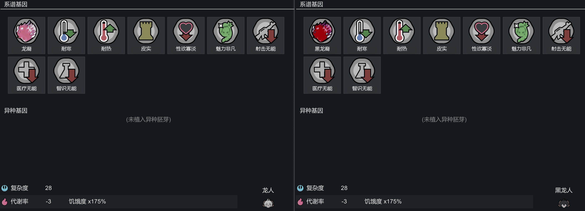
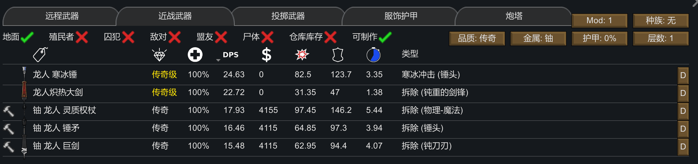
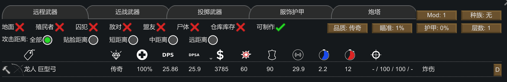

## 种族本体
### 数值概览
|属性|智人种|龙人|
|---|---|---|
|生命值系数|100%|195%|
|基础价值|1750|5800|
|荣誉点数|3|5|
|重量|60|80|
|体型|1|0.9|
|肉量|140|45|
|移动速度|4.6|5.2|
|携带能力|75|150|
|最低舒适温度|16|-45-10|
|最高舒适温度|26|45+10|
|毒素抗性|0%|60%|
|有毒环境抗性|0%|60%|
|崩溃临界值|35%|18%|
|疼痛休克阈值|80%|75%|
|预期寿命|80|850|
|愈合系数|100%|500%/100%×5|
|免疫速度|100%|150%|
|生育周期|15|60|
|营养需求|1|2.3|
|觅食能力|0|5|
|进食速度|100%|125%|
|利器护甲|0%|40%|
|钝器护甲|0%|30%|
|热能护甲|0%|40%|
|近战伤害系数|100%|100%×1.35|
|近战命中率|0|1×1.15|
|近战闪避率|0|1.2|
|射击精度|0|1|
|承伤系数|100%|100%×0.75|
|瞄准时间|100%|125%|
|谈判能力|100%|115%|
|交易价格改善|100%|50%|
|社交效果|100%|125%|
|魅力|0|0+2|
|采矿效率|100%|120%|
|采矿速度|100%|80%|
|手术成功率|100%|25%|
|治疗质量|100%|70%|
|建造速度|100%|90%|
|植物收获效率|100%|120%|
|种植速度|100%|80%|
|食物有毒率|100%|110%|
|烹饪速度|0|1|

 -  男女比为3:7,不生成亲属关系,可穿戴原版衣物,龙人衣物分男女限定,可生成异常尸体,可出现在逃生舱事件,会作为奴隶出现在商队
 -  屠宰产出皮革为轻薄皮革,屠宰额外产出75龙人毛发和1龙珠(仅受屠宰效率影响)
 -  免疫龙卷风伤,免疫低温症,免疫年龄疾病,女龙生育能力恒定为50%,男龙生育能力恒定为300%
 -  新增"尾"内部器官,命中率2.5%,等价于脊椎,影响移动能力;空手攻击为18咬伤/2.6s(下颌),18钝击/2s(双手),25钝击/3s(尾)
 -  将原版野人替换为龙人,生成时至少50岁,且受伤100%反击
 -  除异象聪明的龙人外,其余龙人背景故事禁用烹饪手工艺术智识,带有自然灵媒
 -  可以食用草,灌木等原版植物,每6天产出25龙人毛发,女性龙人每2天产出10龙娘奶,受采集效率影响
 -  带有永久的"龙人自愈"状态,每15~30天自然愈合一个疤痕或老年病(等价于魔鬼素效果,该状态丢失时会尝试重新生成)

龙人的数值填写相当夸张,自行看表即可,以下只对战斗能力和工作能力进行简要评析  
战斗能力上,龙人5.2的移速快人一步,且自带135%近战伤害系数(当然很多情况下近战输出严重溢出),1.95倍血量和75%承伤也是夸张,自带一丢丢三防没啥用,但如果和石肤叠起来数值就很夸张了,再加上男龙人自带坚韧,一个普通的男龙人的血量足足是普通人类的5.2倍  
工作能力上,龙人就是纯纯的区了,先天禁用烹饪手工艺术智识,再加上交易价格改善和手术成功率的先天巨大缺陷,其工作能力仅有建造采矿种植  
龙人没有添加任何派系,获取方式仅有驯服野人,买奴隶和逃生舱随机掉,所以也相当稀有.除此之外值得注意的是龙珠产出受到屠宰效率影响,高屠宰效率有可能一次出两个龙珠,低屠宰效率有概率不出龙珠

### 基因/特性/心情

**基因** 添加了龙人和黑龙人两种异种,自然生成时两者占比为9:1,古怪同伴则为7:3
 -  基因固定为 龙裔/黑龙裔,耐寒,耐热,皮实,性欲寡淡,魅力非凡,射击无能,医疗无能,智识无能

添加了如下基因
 -  龙裔:20复杂度-3代谢 愈合系数×500% 近战伤害系数×135% 近战命中率×115% 烧伤灼伤伤害×85% 酸蚀伤害×10% 冻伤伤害×0% 与近战伤害,愈合速度基因互斥  
    附带"冰霜吐息"技能:0.5s前摇10s cd,7释放半径90°扇形范围,8熵22%精神力消耗,对范围内生物造成50%穿甲(热甲)的20点钝击伤
 -  黑龙裔:20复杂度-3代谢 愈合系数×500% 近战伤害系数×135% 近战命中率×115% 冻伤伤害×85% 酸蚀伤害×10% 烧伤灼伤伤害×0% 与近战伤害,愈合速度基因互斥  
    附带"火焰吐息"技能:0.5s前摇10s cd,7释放半径90°扇形范围,8熵22%精神力消耗,对范围内生物造成0%穿甲的10点烧伤

特别地,这两个技能可作为心灵训练器出售,售价100银

**特性**
 -  龙人必带"俊俏"或"沉鱼落雁",女性必带"乐天派",男性必带"坚韧"
 -  龙人必定没有如下特性:丑陋全家桶,成瘾品全家桶,意志全家桶,神经质全家桶,工作速度全家桶,冷枪手,乱开枪,嗜血,直来直去,聪明过人,贪心,妒忌,苦行者,纵火狂,超人主义,纯粹主义,厌恶男性,厌恶女性

**心情**

点击查看AI扒取特殊心情

龙人免疫如下心情:
 -  裸体,穿着磨损的衣物/穿着破烂的衣物
 -  超人主义拥有身体改造,纯粹主义拥有身体改造
 -  格斗者持有远程武器,纵火狂持有燃烧武器
 -  没有令人印象深刻的卧室(贪心),妒忌他人的卧室
 -  共用床铺,在地上吃饭,在外面睡觉,在地上睡觉,在寒冷中睡觉,在炎热中睡觉
 -  吃了粗饲料,吃了生食,吃了生的/烹饪过的虫肉
 -  吃了生的/烹饪过的人肉,生吃过人肉,屠宰过人类,有人被屠宰了
 -  对丑陋/丑绝人寰者的负面印象

## 杂项
添加了"孤独的龙人"剧本
 -  单龙人开局,中世纪科技,初始完成部落研究,与帝国永久敌对
 -  开局物品 300白银,300土豆,30草药,12零部件,极差钢铁龙人锤矛
 -  第3~4天触发剧本专属事件"天真的脚步声",一名龙人加入殖民地.第10~15天触发原版事件"逃生舱坠毁"

杂项内容
 -  添加了一种物品:龙珠 1300银 等同于治愈机械液,屠宰龙人获得
 -  添加了一种纤维:龙人毛发 11银175%耐久度40%易燃性 三防180/140/120 美观×150% 屠宰龙人或给龙人剪毛获得
 -  添加了一种食物:龙娘奶 8.5银0.1营养值14天腐烂 25%娱乐值,视为医疗类成瘾品
 -  添加了古怪同伴"聪明的龙人",0.15权重,带有专属特性"精密计算的攻击",其正面不可能是转换钢铁,其负面不可能是器官衰竭.最小40岁,可进行任何工作,智识19~20级,艺术9~20级,带有"已绝育"状态  
    精密计算的攻击 治疗质量+30% 手术成功率+75% 交易价格改善+50% 近战伤害系数×120% 近战冷却时间×80% 近战闪避率×120% 射击精度×120% 角色质量+50%

龙珠等价于治愈机械液,自然是相当强力,但龙人刷新率太低了,整体还是很稀有  
龙人毛发也是利器大选手,利器护甲相当高,仅次于超织物的200%,且钝器护甲也异常的高,140%钝防已经是原版超织物的快三倍了,但这其实并无卵用,毕竟原版环境压根不考虑钝防,其次龙人毛发作为龙人的副产物其实相当稀有,每6天产出25龙人毛发,折合每个龙人每年产出250个,考虑到龙人的稀有程度,这获取难度比敲击兽皮都低了  
龙娘奶也是龙人的副产物,每2天产出10奶,而且直接喝奶还带娱乐值,这爽爆了  
精密计算的攻击算是把龙娘的debuff都给砍掉了,不仅能干任何工作,甚至把手术成功率都加回到正常的100%了(但仍然医疗无能),唯一美中不足是权重太低了压根没见到过,为啥龙人开局不送一个聪明的龙人呢,这样龙人开局也能正常游玩了,不用非得绑个其他种族来干活了

## 科技
龙人没有自己的科技树,护甲并入原版板甲,其余均不需要研究

## 武器
龙人武器无种族限定,龙人额外添加了两种战斗属性,以便龙人装备时有额外加成
 -  龙部件(近战):新增属性,龙人基础55点,其余种族默认1点
     1. 每级格斗+0.5点,并计算武器加成(+10或+20)
     2. 按照年龄(13岁,×1)-(50岁,×1.25)-(800岁,×5.5)进行线性插值乘算
     3. 将结算值按照(55,×1)-(100,×2.25)-(200,×3.65)-(300,×5.2)-(420,×6)的线性插值乘算进近战伤害系数
 -  龙部件(远程):新增属性,龙人基础1点,其余种族基础0点,装备远程武器后变为2点,若为2点,则瞄准时间×30%,否则瞄准时间×100%

近战龙部件是将龙人年龄折算为近战伤害系数的方式,800岁龙人+4级格斗+20武器就能顶到6倍近战伤害系数的上限  
野生龙人至少50岁,不妨设20级格斗,武器+20的龙人,其结算值为(55+20×0.5+20)×1.25=106.25,带入线性插值,得到近战伤害系数为2.25+(3.65-2.25)×(106.25-100)/(200-100)=234%,如果去除武器加成,则近战伤害系数为173%,若去掉格斗和武器加成,则近战伤害系数为138%,若算上基因的近战伤害系数×135%,则最终为187%  
同理,我们计算400岁20级格斗武器+20的龙人,其近战伤害系数为481%,若去除武器加成,则近战伤害系数为381%,若去掉格斗和武器加成,则近战伤害系数为334%

### 近战武器

 -  锤矛:80金属+60钢铁+40龙人毛发+10手工 27(钝击,拆除)/3.65s 8捅伤/2s 龙部件(近战)+10
 -  巨剑:80金属+60钢铁+40龙人毛发+10手工 29(割伤,拆除)/3.78s 8捅伤/2s 龙部件(近战)+10
 -  灵质权杖:80金属+80钢铁+40龙人毛发+10手工 40(钝击,拆除)/5s 8捅伤/2s 龙部件(近战)+10 心灵敏感度+50% 心灵熵消散速率+0.083 钝击和拆除附带4.5点emp伤,并有25%概率附带1.5点眩晕
 -  寒冰锤:无法制作的人格武器 50钝击/3.35s 龙部件(近战)+20 每点实际伤害附加0.3%的"低温症"状态(受体型放缩),该状态每天自然下降250%.有-11制冷能力(等价于蒸发制冷器)  
    状态值≥4%(身体颤抖) 意识-5% 操作能力-8%  
    状态值≥20%(轻微) 意识-10% 移动能力-10% 操作能力-20%  
    状态值≥35%(严重) 意识-20% 移动能力-30% 操作能力-50% 疼痛+15%  
    状态值≥62%(极重度) 意识上限10% 疼痛+30%  
    状态值=100% 死亡
 -  炽热大剑:无法制作的人格武器 19(割伤,拆除,横扫攻击)/1.38s 龙部件(近战)+20 选中横扫攻击时,转为对目标及其身后的2×3范围造成100%穿甲的40点烧伤 环境温度高于80℃时有11制热能力

龙人近战武器并没有值得讲述的内容,他们的共通特点都是大力气,伤害高攻速低.特别地,当近战伤害严重溢出时,可以使用近战冷却时间更短的玻璃钢来锻钝器刀

### 远程武器

 -  巨型弓:160钢铁+40龙人毛发 龙部件(远程)+1 造成3.1误差半径4爆炸半径60%穿甲的40炸伤,龙人使用时前摇为4.5s

这把弓非常有说头,超长前摇中范围高伤害,由于龙人禁止了乱开枪特性,这把武器在龙人手里就是半残废,但在乱开枪射击专家智人种手里,这就是手持高精度高穿甲迫击炮,一炮下去死一群,整个灵能隐身为他创造输出环境就能轻松单刷1w点袭击

## 战斗衣物
 -  衣物均为龙人专属衣物,除头盔和防护宝珠外,龙人衣物分男女
 -  龙人的普通衣物几乎没有防护能力,额外buff仅有真空抗性+45%及奴隶服的压制下降率偏移,故不再统计.穿戴眼罩时视力上限20%
 -  童装:25皮革或纤维+20龙人毛发 60%+20%S 真空抗性+45%
 -  战盔A型:40金属+25钢铁 40%+75%S 真空抗性+50%
 -  战衣:100金属+40龙人毛发 60%+80%S 真空抗性+50%
 -  灵质战盔:40金属+25钢铁 20%+75%S 心灵敏感度+25% 心灵熵消散速率+0.106 真空抗性+50% 压制下降率偏移-20%
 -  灵质战衣:40金属+40龙人毛发 30%+80%S 心灵敏感度+30% 心灵熵消散速率+0.103 压制下降率偏移-20% 真空抗性+50%
 -  防护宝珠:100金属+40龙人毛发 58%+78%S 真空抗性+100%
 -  Dragonian Strange Apparels新添加的衣物与战衣战盔数值完全相同,但头饰不防护耳朵鼻子

衣物也是简单粗暴的利器大,拿100钢铁+40龙毛就能搓128.2%防的防护宝珠,比骑士甲还高一头,玻璃钢搓出来更是有146.9%利防,极佳品质就能有191%利防,且只占用了夹层头饰,甚至外套和贴身还能套一层敲击兽皮防尘大衣和衬衫来进一步多层护甲叠叠乐  
另外别忘了龙人还自带40%利防呢,但看这玩意确实没啥用,但是和石肤腺体叠加起来就变成了全身110%防,对于20%穿甲来说相当于32.5%的承伤乘区

简单算一下防护能力
 -  极佳钢铁骇人皮革 防尘大衣+防护宝珠+衬衫+自带防(49.5;166.7;33;40);在20%穿甲下护甲承伤为13%,若换为玻璃钢,则为8%
 -  传奇玻璃钢敲击兽皮 防尘大衣+防护宝珠+衬衫+自带防(112.3;200;74.9;40);在20%穿甲下护甲承伤为6.1%,若叠加石肤腺体,则为2.3%
 -  作为对比,原版传奇骑士套在20%穿甲下护甲承伤为8.8%

叠了石肤满甲龙人的期望血量是原版骑士套智人的3.82倍左右,再叠加龙人自带的1.95倍血量,满甲龙人血量大概是满甲智人种的7.45倍,且男性龙人固定带坚韧,免去了刷特性的烦恼,再叠上基因的皮实,满甲龙人的坦度可以说是相当吓人,在护甲耐久掉光之前都不带掉血的