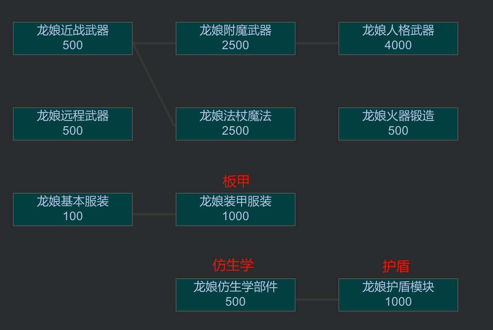
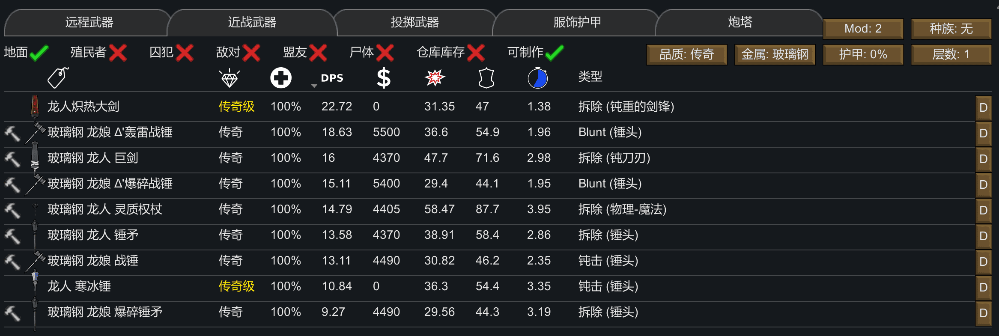
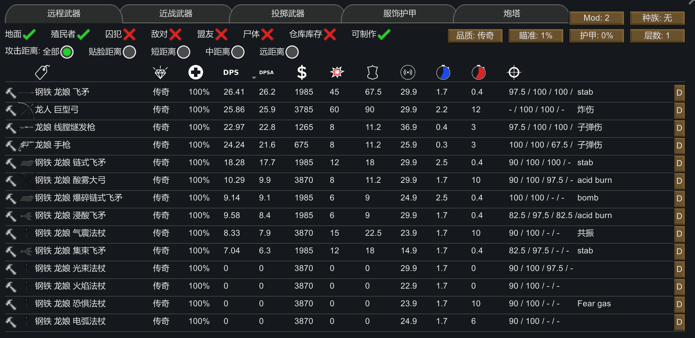

### 种族本体

 -  移除龙人背景故事的工作禁用,部分背景故事会强制附带特性
 -  移除屠宰产出龙珠,并将龙珠改为内部器官,命中率1%,不影响任何能力,可使用10玻璃钢安装玻璃龙珠(安了也没用)
 -  野生龙人有30%概率带有特殊龙尾,派系的龙人黑龙人比例为85:15
 -  冰霜吐息技能改为100%穿甲的20点急速冷却伤
 -  火焰吐息技能改为0%穿甲的10点护甲熔解伤

### 科技与剧本

添加了新的科技树,并将原版龙人的相关科技并入"龙娘科技"研究内

将原版龙娘剧本初始研究由部落改为迫降,并添加了新的剧本 龙娘新窝
 -  3龙人开局,中世纪科技,初始完成迫降研究,与帝国永久敌对
 -  开局物品:极佳龙娘手枪,极佳龙娘线膛燧发枪,3龙珠,100布,400原木
 -  每10天触发一次野人出现

## 元素
爆炸类型都不会伤害携带者(被自爆的那个人)
 -  护甲熔解:热防判定,命中时可点燃目标,每点实际伤害累计2%护甲熔解状态值,每天自然下降400%  
    状态值≥20%(较轻) 热防-15% 烧伤灼伤受伤×2  
    状态值≥35%(中等) 热防-35% 烧伤灼伤受伤×3.5  
    状态值≥50%(严重) 热防-65% 烧伤灼伤受伤×4.5  
    状态值≥65%(极重) 热防-80% 烧伤灼伤受伤×6  
    状态值≥85%(完全) 热防-200% 烧伤灼伤受伤×8
 -  高压触电:热防判定,命中时可点燃目标,每点实际伤害累计2%高压触电状态值,每天自然下降400%,持续期间每40tick受到1~5点emp伤  
    状态值≥20%(较轻) 移动操作能力-20%  
    状态值≥35%(中等) 移动操作能力-40%  
    状态值≥50%(严重) 移动操作能力-60%  
    状态值≥65%(极重) 移动操作能力-80%  
    状态值≥85%(完全) 移动操作能力最大0%
 -  急速冷却:热防判定,每点实际伤害累计1%急速冷却状态值,每天自然下降600%,持续期间每1.5s受到1~2点眩晕  
    状态值≥20%(2/8) 意识-10% 最低舒适温度+40℃  
    状态值≥35%(3/8) 意识-20% 最低舒适温度+80℃  
    状态值≥50%(4/8) 意识-20% 最低舒适温度+120℃  
    状态值≥65%(5/8) 意识-30% 最低舒适温度+160℃  
    状态值≥85%(6/8) 意识-30% 最低舒适温度+200℃  
    状态值≥125%(7/8) 意识-50% 最低舒适温度+500℃  
    状态值≥250%(8/8) 意识-50% 最低舒适温度+1000℃
 -  FrostCoverd:热防判定,每点实际伤害累计1%FrostCoverd状态值(受体型缩放),2s后爆炸,造成4半径10%穿甲的5点急速冷却伤,并生成4半径的冻雾  
    状态值≥20%(较轻) 移动能力-10%  
    状态值≥35%(中等) 移动能力-20%  
    状态值≥50%(严重) 移动能力-30%  
    状态值≥65%(极重) 移动能力-40%  
    状态值≥85%(完全) 移动能力-50%
 -  冷冻摧毁机制:使用急速冷却或FrostCoverd伤害类型对带有"急速冷却"状态的目标造成伤害时,若单次伤害达到目标受击部位最大生命的指定比例,则有25%概率直接摧毁该部位  
    状态值≥20%(2/8) 需造成该部位最大生命80%伤害  
    状态值≥35%(3/8) 需造成该部位最大生命65%伤害  
    状态值≥50%(4/8) 需造成该部位最大生命50%伤害  
    状态值≥65%(5/8) 需造成该部位最大生命35%伤害  
    状态值≥85%(6/8) 需造成该部位最大生命15%伤害  
    状态值≥125%(7/8) 需造成该部位最大生命1%伤害  
    状态值≥250%(8/8) 需造成该部位最大生命0.1%伤害
 -  酸性沾染:利防判定,每点实际伤害累计1%酸性沾染状态值,每天自然下降400%,最长30s,持续期间每40tick受到1~5点无视护甲的酸性腐蚀伤 使用承伤减益  
 -  酸雾沾染:利防判定,每点实际伤害累计1%酸性沾染和酸雾沾染状态值,2s后爆炸,造成2半径10%穿甲的5点酸性腐蚀伤,并有10%概率生成一格酸雾
    状态值≥20%(较轻) 承伤×125%  
    状态值≥35%(中等) 承伤×175%  
    状态值≥50%(严重) 承伤×235%  
    状态值≥65%(极重) 承伤×285%  
    状态值≥85%(完全) 承伤×325%
 -  酸性腐蚀:利防判定,每点实际伤害累计1%酸性腐蚀状态值,每天自然下降400%,最长30s  
    状态值≥20%(较轻) 利防-15% 钝防-10%  
    状态值≥35%(中等) 利防-35% 钝防-30%  
    状态值≥50%(严重) 利防-65% 钝防-60%  
    状态值≥65%(极重) 利防-80% 钝防-75% 承伤×285%  
    状态值≥85%(完全) 双防-200%
 -  黏菌附着:利防判定,每点实际伤害累计1%黏菌附着状态值(受体型缩放),3.3s后爆炸,造成3半径10%穿甲的30点炸伤 使用移动能力减益  
 -  黏菌附着(小):利防判定,每点实际伤害累计1%黏菌附着(小)状态值(受体型缩放),1.7s后爆炸,造成2半径10%穿甲的5点炸伤 使用移动能力减益  
    状态值≥20%(较轻) 移动能力-10%  
    状态值≥35%(中等) 移动能力-20%  
    状态值≥50%(严重) 移动能力-30%  
    状态值≥65%(极重) 移动能力-40%  
    状态值≥85%(完全) 移动能力-50%
 -  死灵病毒:无视护甲承伤,每点实际伤害累计4%死灵病毒状态值,每天自然下降400%,持续期间死亡直接变为敌对派系蹒跚怪
    状态值≤50%(潜伏期) 平均5天呕吐一次  
    状态值≥50%(活跃期) 疼痛×150% 平均每天呕吐一次  
    状态值≥75%(终末期) 意识最大70% 疼痛×200% 平均0.5天猝死一次  
    状态值≥95%(终末期) 死亡

护甲熔解是一个完全没用的元素,降低热防效果较为一般,易伤效果则完全没用,它只对原版的烧伤灼伤有易伤效果,你好歹是给护甲熔解伤加易伤啊,鉴定为NPC  
高压触电就很强了,虽然emp数值低下,但状态强力,只需42.5伤就能让敌人移动能力归零强制倒地,目标是成为肾肺心大师,综合给到夯爆了  
急速冷却也相当强力,他每1.5s会造成0.5s~1s眩晕,全宇宙最强的控制,当敌对龙人对你使出冰霜吐息时,你就会了解这个眩晕机制是多么恶心的存在.除此之外还有一个存在感略低的冷冻摧毁机制,综合给到夯爆了  
FrostCoverd甚至没有翻译,其主要贡献是产生冻雾可以给附加强力的急速冷却状态,其主要问题在于冻雾是不分敌我的aoe技能,对于龙人这样一个近战为主的种族,冻雾同时会对己方施加急速冷却状态进而造成眩晕,考虑到使用得当可以对敌人造成很强力的眩晕,综合给到人上人  
酸性沾染数值平庸,每40tick受1~5点酸性腐蚀伤,折合4.5的dps,给到平平无奇的NPC  
酸雾沾染存在感也相当低,但同样由于是不分敌我的aoe,其对己方的影响可能大于对敌方的影响,给到拉完了  
酸性腐蚀更诡异了,减双防本身只对生物自身的防御有效,承伤增加竟然只在极重时生效,在完全时候竟然就没了  
黏菌附着则是史上第二的骗局,表面上是大范围aoe,实则是对己方的大范围aoe,如果你列装了黏菌附着武器,你会惊人地发现,怎么自家龙人受到的伤害全tm是炸伤  
死灵病毒更是史上最大的骗局,死亡变成蹒跚怪是好事,等等,什么叫tm敌对蹒跚怪?你的意思是我杀死敌人一次之后还得杀他第二次,甚至宰掉之后会直接腐烂不给吃肉?给到唯一的拉完了

气体:仅对非机械体生物生效,受毒素抗性影响
 -  恐惧毒气:持续30~50s,每2s施加1%~100%的恐惧毒气状态
 -  酸雾:持续30~50s,每4s施加1%~10%的酸性沾染状态
 -  冻雾:持续5~10s,每4s施加1%~10%的急速冷却状态
 -  霜雾:持续5~10s,每4s施加1%~10%的FrostCoverd状态

## 特殊龙珠
特殊龙珠不可制作,只能任务获得或作为仿生体在商队或据点刷新,除酸解龙珠为400银外均为1000银,且植入龙珠手术一定成功
 -  穿戴或植入龙珠造成伤害时(无论近战远程),额外对受伤部位造成10%穿甲,20%×实际伤害值的特定元素伤害(最低0.5伤),若穿戴一个龙珠植入一个龙珠,元素附伤可叠加
 -  植入龙珠时,还会有额外技能,龙珠额外技能还会作为心灵训练器出售,每个100银

龙珠的附伤并不如想象中那么强力,首先基础伤害会过一遍护甲和承伤作为实际伤害,而附伤是20%的实际伤害,且附伤也要过一遍护甲和承伤,折合下来附伤相当于要过两次护甲和承伤,同时附伤均为10%穿甲,可以说面对中高甲的情况下几乎没有附加伤害.尤其是使用几个热防判定的伤害类型攻击200%热防的机械族时,可以说是近乎可以忽略附加伤害

具体龙珠如下
 -  火炎龙珠:附伤为护甲熔解伤.植入时额外获得如下两个技能  
    火焰喷射:0.5s前摇30s cd,23释放半径13°扇形范围,30熵4%精神力消耗,对范围内生物造成45%穿甲的30点护甲熔解伤  
    火焰爆发:1.5s前摇1天cd,13爆炸半径,30熵4%精神力消耗,对范围内生物(包括自身)造成120%穿甲的80点护甲熔解伤
 -  雷光龙珠:附伤为高压触电伤.植入时额外获得如下两个技能  
    雷电招来:1s前摇30s cd,25释放半径5爆炸半径,35熵4%精神力消耗,对范围内生物造成100%穿甲的45点高压触电伤  
    闪电风暴:1s前摇1天cd,30释放半径13爆炸半径,50熵8%精神力消耗,同原版闪电风暴,伤害被替换为100%穿甲的45点高压触电伤
 -  冰结龙珠:附伤为FrostCoverd伤.植入时额外获得如下技能  
    冰淞云雾:1s前摇1天cd,25释放半径7爆炸半径,25熵4%精神力消耗,对范围内生物造成50%穿甲的20点FrostCoverd伤,并在范围内生成霜雾和致盲烟雾
 -  酸解龙珠:附伤为酸性沾染伤,植入时额外获得如下两个技能,植入且死亡时溶解所有装备,并对7半径的生物造成0%穿甲的40点酸性沾染伤
    酸液喷吐:0.5s前摇30s cd,23释放半径4爆炸半径(残缺),25熵3%精神力消耗,对范围内生物造成80%穿甲的30点酸性沾染伤
    酸性云雾:1s前摇1天cd,25释放半径10爆炸半径,20熵3%精神力消耗,对范围内生物造成50%穿甲的25点酸性沾染伤,并在范围内生成酸雾和致盲烟雾
 -  毒素龙珠:附伤为原版毒击,植入时额外获得如下技能  
    释放有毒气体:1s前摇1天cd,25释放半径10爆炸半径,20熵3%精神力消耗,生成10半径的原版毒气
 -  死灵龙珠:附伤为死灵病毒伤,植入时额外获得如下技能  
    死灵尘雾:1s前摇1天cd,25释放半径10爆炸半径,35熵5%精神力消耗,生成10半径的原版死灵尘
 -  超再生珠:植入时,愈疗100耐久/天,并获得如下技能  
    超再生爆发:0.5s前摇1天cd,15熵3%精神力消耗,为自身施加150s的"超再生爆发"状态,愈疗1000耐久/天,疼痛×10%
 -  硬化龙珠:植入时 双防+70%/50%
 -  末影龙珠:植入时获得如下两个技能
    折跃:0.25s前摇30s cd,31释放半径,25熵2%精神力消耗,同原版折跃
    远距离折跃:5s前摇1天cd,40熵3%精神力消耗,同原版远距离折跃

火炎龙珠作为装备较为一般,毕竟护甲熔解状态本身一般  
火焰喷射是平平无奇的aoe技能,伤害尚可但范围诡异,相比于其他超模的龙人技能,就显得很垃圾了  
火焰爆发就很奇葩了,13半径120%穿甲80伤,但会伤到自己,属于是局限性较大的技能,解决自伤问题后这个数值就相当狂暴了,折跃进场直接开大,能直接单刷1w点人类袭击  
雷光龙珠很适合作为装备,高压触电高贵的强制移动能力归零  
雷电招来强度优秀,5半径100%穿甲45点高压触电,45点高压触电伤害如果打满足以让范围内生物全部倒地  
闪电风暴就十分幽默了,幽默雷电速度幽默判定但严肃伤害,伤害惊人但打不中人,你和原版闪电风暴坐一桌去  
酸解龙珠作为装备也较为优秀,白送的4.5dps谁不想要呢  
酸液喷吐完全是雷电招来的下位替代,虽说也是大范围高伤害aoe,但范围穿甲伤害都比雷电招来低一些  
酸性云雾路边一条,在其他大招都在直接秒人的时候,酸解的大招竟然是给敌人施加低伤害自爆buff,真是野狗  
毒素龙珠更是幽默,原版毒伤都来了,毒吃多了该吃尸体腐败肺瘟喽,千万别植入毒素龙珠  
释放有毒气体真是给我整笑了,释放原版毒气都来了,喜欢毒气阵地的宝宝们有福了  
死灵龙珠由于逆天的死灵病毒复活成敌人,给到拉中拉  
死灵尘雾的高强度源于死灵尘本身的高强度,直接生成大范围死灵尘,这谁不怕啊,只可惜其他技能都能直接秒一切了,所以这个技能也只能沦为路边的野狗了
超再生珠没有任何穿戴作用,作为植入物时每天有100点愈疗效果,本身相当强力,但奈何超再生爆发这个技能

除此之外还有一个技能,仅能用技能训练器获得
 -  恐惧毒雾:1s前摇1天cd,25释放半径10爆炸半径,20熵3%精神力消耗,生成10半径的恐惧毒气  
    状态值<200%(较轻) 视觉能力-30% 呼吸能力-15% 崩溃临界值+14%  
    状态值≥200%(中等) 视觉能力-60% 呼吸能力-30% 崩溃临界值+42% 疼痛×120%  
    状态值≥300%(严重) 视觉能力最大0% 呼吸能力-60% 崩溃临界值+100% 疼痛×200%

 -  护盾龙珠:植入后获得100点个人护盾,每秒回复0.3盾,吸收任何伤害(包括近战伤害)且可正常射击,受到emp伤时破碎  
    若单次伤害大于击破前剩余护盾的2倍且剩余护盾低于上限一半,则该次伤害穿透;否则该次伤害仍被完全吸收  
    破碎后5秒重置,重置时从0开始恢复
 -  护盾赤色充能源石=15玻璃钢+40铀+1黄金+2零部件+8手工 护盾上限+100 回复+0.6/s 护盾重置时间+5s
 -  护盾橙色充能源石=15玻璃钢+40铀+1黄金+2高级零部件+8手工 护盾上限+200 回复+1.2/s 护盾重置时间+5s
 -  护盾适应源石=15玻璃钢+40铀+1黄金+2高级零部件+8手工 护盾重置时间+5s 受到与上一次相同类型的伤害时,护盾消耗依次为×1.0/0.8/0.6/0.4/0.2(连续同类最低×0.2),换成新伤害类型时为×1.2并重新计数 与缓冲冲突
 -  护盾缓冲源石=15玻璃钢+40铀+1黄金+2高级零部件+8手工 护盾重置时间+5s 每次受伤最多扣除10点护盾(不防emp),护盾上限减半 与适应冲突

## 武器
### 近战武器

修改了原版龙人武器的伤害类型
 -  寒冰锤:无法制作的人格武器 22钝击+20FrostCoverd伤+11眩晕伤/3.35s 龙部件(近战)+20 有-11制冷能力(等价于蒸发制冷器),移除附加低温症  
 -  炽热大剑:无法制作的人格武器 19(割伤,拆除,横扫攻击)/1.38s 龙部件(近战)+20 选中横扫攻击时,转为对目标及其身后的2×3范围造成100%穿甲的40点护甲熔解伤 环境温度高于80℃时有11制热能力

添加了四种新近战武器
 -  战锤:80金属+40钢铁+5零部件+40龙人毛发 21钝击+7高压触电伤+15emp伤/3s 17捅伤+5emp伤/2s 龙部件(远程)+1 钝击权重翻10倍
 -  爆碎锤矛:80金属+40钢铁+5零部件+40龙人毛发 20(钝击,拆除)+20黏菌附着伤+6眩晕伤/4s 8捅伤/2s 龙部件(远程)+1 钝击拆除权重翻10倍
 -  Δ轰雷战锤:400金属+400龙人毛发+1人格核心+5高级零部件 人格武器 25钝击+14高压触电伤+15emp伤/2.5s 17捅伤+5emp伤/1.5s 钝击权重翻10倍  
    使用钝击命中敌人时,额外对被攻击者6半径内的至多5个敌人造成-100%穿甲的25点高压触电伤(无法触发龙珠附伤)  
    使用钝击命中敌人时,为自身添加0.5的"唤醒心灵"状态,最大持续30s,状态值增加时刷新时间  
 -  Δ爆碎战锤:400金属+400龙人毛发+1人格核心+5高级零部件 人格武器 20钝击+20黏菌附着伤+11眩晕伤/2.5s 17捅伤/1.5s 钝击权重翻10倍
    使用钝击命中敌人时,额外对被攻击者4半径内的至多3个敌人造成-100%穿甲的20点黏菌附着伤(无法触发龙珠附伤)  
    使用钝击命中敌人时,为自身添加0.5的"唤醒心灵"状态,最大持续30s,状态值增加时刷新时间  
    状态值>0 近战伤害系数+20%  
    状态值≥4 近战伤害系数+40% 近战冷却时间-20%  
    状态值≥8 近战伤害系数+60% 近战冷却时间-40%  
    状态值≥12 近战伤害系数+80% 近战冷却时间-60%  
    状态值≥16 近战伤害系数+100% 近战冷却时间-80%

### 龙尾
添加了两种普通龙尾仿生体和五中攻击龙尾仿生体,后者均为100%效率且不可制作,只能任务获得或作为仿生体在商队或据点刷新,除斩龙尾为300银外均为500银,均为100%效率,且带有移动能力-8%
 -  假龙尾:85布 35%效率
 -  仿生尾:15玻璃钢+4高级零部件 125%效率
 -  斩龙尾:40割伤/3s
 -  焚斩尾:30割伤+20护甲熔解伤/3s
 -  酸斩尾:30割伤+20酸性沾染伤/3s
 -  碎斩尾:30钝击+15黏菌附着伤+15眩晕伤/3s
 -  霜斩尾:30割伤+20FrostCoverd伤/3s

### 远程武器

 -  线膛燧发枪:60钢铁+3零部件 **图片显示dps有问题,实际为5颗弹丸,dps乘5** 龙部件(远程)+1 使用刺伤
 -  手枪:30钢铁+2零部件 **图片显示dps有问题,实际为3颗弹丸,dps乘3** 龙部件(远程)+1
 -  飞矛:80金属+20龙人毛发+10手工 龙部件(远程)+1
 -  集束飞矛:80金属+20龙人毛发 **图片显示dps有问题,实际为3颗弹丸,dps乘3** 龙部件(远程)+1
 -  链式飞矛:80金属+20龙人毛发 龙部件(远程)+1
 -  浸酸飞矛:80金属+20龙人毛发 龙部件(远程)+1 伤害类型为酸性沾染
 -  爆碎链式飞矛:80金属+20龙人毛发 龙部件(远程)+1 伤害类型为黏菌附着(小)
 -  酸雾大弓:80金属+40龙人毛发+40钢铁+5零部件 无需视线 龙部件(远程)+1 攻击生物时必定命中目标,对落点造成2半径的5点酸雾沾染伤(受品质影响)和3半径的5点酸雾沾染伤,并在落点6半径内随机3处造成2半径的5点酸雾沾染伤
 -  气震法杖:80金属+40龙人毛发+40钢铁+5零部件 无需视线 心灵敏感度+50% 心灵熵消散速率+0.083 龙部件(远程)+1 攻击生物时必定命中目标,造成4爆炸半径的两次10共振伤(第一次伤害受品质影响)
 -  恐惧法杖:80金属+40龙人毛发+40钢铁+5零部件 心灵敏感度+50% 心灵熵消散速率+0.083 龙部件(远程)+1 生成6半径的恐惧毒气,吸入获得"恐惧毒气"状态,
    每天自然下降3000%,平均每天狂暴一次
    状态值≥0% 视觉能力-30% 呼吸能力-15% 崩溃临界值+14%
    状态值≥200% 视觉能力-60% 呼吸能力-30% 崩溃临界值+42% 疼痛×120%
    状态值≥300% 视觉能力最大0% 呼吸能力-60% 崩溃临界值+100% 疼痛×200% 
 -  电弧法杖:80金属+40龙人毛发+40钢铁+5零部件 心灵敏感度+50% 心灵熵消散速率+0.083 龙部件(远程)+1 6s前摇无后摇,攻击时,对40°扇形内最多4个非友方且站立的单位造成100%穿甲的15点高压触电伤(伤害穿甲受品质影响)和20点emp伤
 -  火焰法杖:80金属+40龙人毛发+40钢铁+5零部件 心灵敏感度+50% 心灵熵消散速率+0.083 无前摇1.7s后摇,每0.5s对指定格造成1半径0%穿甲的5点护甲熔解伤和2半径0%穿甲的5点护甲熔解伤
 -  光束法杖:80金属+40龙人毛发+40钢铁+5零部件 心灵敏感度+50% 心灵熵消散速率+0.083 无前摇1.7s后摇,每0.5s对指定格造成1半径0%穿甲的2.5点FrostCoverd伤和2半径0%穿甲的2.5点FrostCoverd伤

特别地,这些武器的武器特性是固定的,且没有实际效果(仅用于描述武器性质)

### 衣物
 -  制式战盔C/D型号:25钢铁 92/40/46三防
 -  制式战衣:100钢铁+40龙人毛发 92/40/46三防 装备时附带"骑士之力"状态,抑止时间乘数×0%

## 派系
添加了两个派系
 -  龙之谷:默认中立的中世纪科技等级派系,商队为原版批发贸易商,作战补给商,稀有品贸易商.据点固定售卖50~500龙人毛发
 -  恶龙咆哮:默认敌对的太空科技等级派系,商队为原版批发贸易商,作战补给商,稀有品贸易商.据点固定售卖50~500龙人毛发

添加了如下头衔,头衔无卧室要求,荣誉点数仅能任务获得
 -  陌生人:8点数,授予1许可,总计8点数
 -  知名者:12点数,授予2许可,总计20点数
 -  可信者:24点数,授予3许可,总计44点数
 -  龙娘酋长/龙娘公主:不可获得

添加了如下许可
 -  请求开心小礼包:最低陌生人,20天cd,4再使用消耗 空投250钢铁+5零部件+20包装生存食物+500白银
 -  请求药物:最低陌生人,20天cd,8再使用消耗 空投20草药
 -  请求衣物:最低陌生人,20天cd,8再使用消耗 空投3件龙人毛发基本连衣裙
 -  请求龙娘毛发:最低陌生人,20天cd,8再使用消耗 空投100龙人毛发
 -  呼叫龙娘工程队:最低知名者,40天cd,4再使用消耗 帝国穿梭机送来4个龙人村民工作4天
 -  呼叫龙娘卫队:最低知名者,40天cd,6再使用消耗 召唤4个近战龙人友军
 -  呼叫龙娘骑兵队:最低知名者,40天cd,6再使用消耗 召唤4个远程龙人友军
 -  呼叫龙娘承包商:最低可信者,升级自工程队,60天cd,8再使用消耗 帝国穿梭机送来8个龙人村民工作4天
 -  呼叫龙娘皇家近卫队:最低可信者,升级自卫队,40天cd,8再使用消耗 召唤6个近战龙人友军
 -  呼叫龙娘骑兵团:最低可信者,升级自骑兵队,40天cd,8再使用消耗 召唤6个远程龙人友军

描述说友军重甲,但其实完全没甲

AI扒取趣事
 -  把本该加给"龙人 巨型弓"的研究前置错误地加到了"龙人 灵质权杖"上,结果:巨型弓无任何研究要求;灵质权杖需要"龙娘远程武器+龙娘附魔武器"(且会报重复节点红字)
 -  "龙娘 碎斩尾"被拆除时掉落的物品是"龙娘 酸斩尾"
 -  "酸解龙珠"在被手术拆除时掉落的物品错误配置为"硬化龙珠"